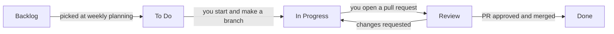
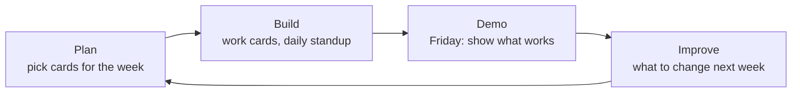

# Our task board: GitHub Projects (Kanban)

All our work lives on one board in GitHub Projects. This guide shows how it works, step by step.

## What is Kanban?

Kanban is a way to see all the work in one place.

- Every task is a **card**.
- The board has **columns**, one for each stage of work.
- Cards move **left to right** as the work gets done.

One look at the board tells you what everyone is working on, what's stuck, and what's next.

## Our board

We use 5 columns:

| Column | What it means | Who moves the card here |
|---|---|---|
| **Backlog** | Every task we know about but haven't planned yet | Khair adds new cards here |
| **To Do** | Picked for this week and ready to start | Khair, at weekly planning |
| **In Progress** | Someone is working on it right now | You, when you start |
| **Review** | A pull request is open and waiting for a check | You, when you open the PR |
| **Done** | Merged into `main` and working | GitHub, when the PR is merged |

Here's what the board might look like in week 2:

| Backlog | To Do | In Progress | Review | Done |
|---|---|---|---|---|
| #20 Share to the GC | #12 City picker *(Miguel)* | #14 Rain check *(Fredelina)* | #11 Save forecasts *(MJ)* | #10 Repo setup *(Khair)* |
| #21 Compare two cities | #13 Heat card design *(Joan)* | #16 Advice prompt *(JC)* | | #9 Screen sketches *(Joan)* |

## The life of a card



Going back from **Review** to **In Progress** is normal. It just means the review found something to fix.

## What a card looks like

Every card on our board is a GitHub **issue**, so it gets a number like `#12`. Branches and pull requests use that number to link back to the card.

```
Title:     Build the city picker
Assignee:  Miguel
Labels:    frontend

A dropdown to choose a city. The 7-day forecast updates when you pick one.

Done when:
- [ ] Shows every city from the city list
- [ ] Picking a city loads its forecast
- [ ] Shows a friendly message if loading fails
```

The **Done when** list tells you when to stop. If every box is checked, the card is ready for review.

## Board rules

1. **Keep cards small**: 1 to 2 days of work. Too big? Ask Khair to split it.
2. **Every card has a "Done when" list.**
3. **Max 2 cards In Progress per person.** Finish one before starting another.
4. **One branch per card.** Open a pull request to move it to Review.
5. **Stuck in In Progress for more than 2 days?** Khair will check in. That's to help, not to blame.

## Your routine, step by step

### 1. Find your cards

Open the repo on GitHub, click the **Projects** tab, then open our board. Type `assignee:@me` in the filter bar to see only your cards.

### 2. Start a card

1. Drag the card from **To Do** to **In Progress**. You can also open the card and change its **Status**.
2. Make sure you're the assignee.
3. Make a branch for it. On the issue page, under **Development**, click **Create a branch**. Or use Git: `git switch -c 12-city-picker`.

### 3. While you work

- Learned something others should know? Add a comment on the card.
- Blocked? Add the `blocked` label and say so in the group chat the same day.

### 4. Open a pull request

1. Push your branch and open a PR on GitHub.
2. In the PR description, write `Closes #12` (your card's number). This links the PR to the card.
3. Move the card to **Review**.

### 5. Finish

1. Fix any review comments on the same branch.
2. When the PR is approved and merged, GitHub closes the issue and moves the card to **Done** for you.

See [CONTRIBUTING.md](../CONTRIBUTING.md) for the Git commands behind each step.

## The weekly loop



The Friday demo is the most important step. Show what works, even if it's small.

## Common questions

**My card didn't move to Done.**
Check that the PR description says `Closes #12` with the right number, and that the PR was merged into `main`. If it still didn't move, drag it yourself.

**I have 3 cards In Progress.**
Finish one, or move one back to **To Do**.

**My card is too big.**
Tell Khair. Splitting it into two smaller cards is a normal part of the process.

**Two people are working on the same card.**
Talk in the group chat. One card has one owner.

## Words to know

| Word | Meaning |
|---|---|
| Card | One task on the board. On our board it's a GitHub issue. |
| Issue | A task or bug on GitHub, with a number like `#12` |
| Status | The card's column: Backlog, To Do, In Progress, Review or Done |
| Assignee | The person working on the card |
| Label | A tag like `frontend`, `bug` or `blocked` |
| Pull request (PR) | Asking the team to check your work and add it to `main` |
| `Closes #12` | Words in a PR that close issue 12 when the PR is merged |
| Backlog | All the tasks we haven't started |

---

## Setting up the board (for Khair, one time)

1. **Create the project.** Click your profile picture, then **Your projects**, then **New project**. Pick the **Board** template and name it `PH Weather Advisory`.
2. **Set the columns.** The columns come from the **Status** field. The Board template starts with Todo, In Progress and Done. Rename Todo to To Do, add **Backlog** and **Review**, and drag them into order.
3. **Link it to the repo.** In the repo, open the **Projects** tab and click **Link a project**.
4. **Turn on the automations.** Open the project's menu (**⋯**), then **Workflows**:
   - **Item added to project**: set Status to Backlog.
   - **Item closed** and **Pull request merged**: set Status to Done. These are usually on already.
   - **Auto-add to project**: add new issues from this repo automatically.
5. **Add labels** in the repo (**Issues**, then **Labels**): `frontend`, `backend`, `data`, `ai`, `design`, `qa`, `bug`, `blocked`.
6. **Invite the team.** Add everyone as a collaborator on the repo (**Settings**, then **Collaborators**) and on the project (project **Settings**, then **Manage access**).
